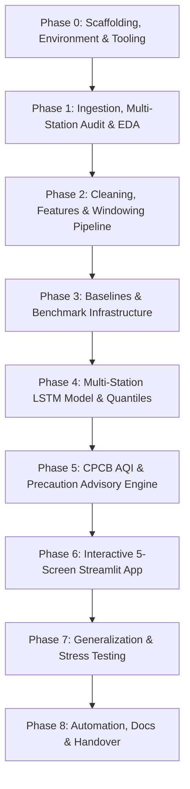

# Project Execution Phases: Multi-Station LSTM PM2.5 & PM10 Forecasting (Korba)

> **Document Status:** Planned (Pre-implementation)  
> **Target Region:** Korba, Chhattisgarh (Industrial & Mining Hub)  
> **Data Sources:** Chhattisgarh Environment Conservation Board (CECB) / Central Pollution Control Board (CPCB)  
> **Reference PRD:** [PRD_PM25_PM10_Forecasting_Korba (1).md](./PRD_PM25_PM10_Forecasting_Korba%20(1).md)

---

## 1. Executive Summary & Project Architecture

### 1.1 Problem Statement
Korba is a major industrial hub with extensive coal mining and thermal power plants, resulting in high concentrations of particulate matter ($\text{PM}_{2.5}$ and $\text{PM}_{10}$). Regulatory authorities publish historical and near-real-time observations, but do not provide forward-looking multi-day forecasts. Industrial operators and the public cannot anticipate hazardous pollution events 72 hours in advance to take adequate health and operational precautions.

### 1.2 System Vision & Core Objectives
1. **Model Paradigm:** A unified, joint deep learning architecture (Conv1D + BiLSTM + LSTM + Attention + Quantile Pinball Loss + Station Embeddings) trained across $\ge 2$ years of continuous data from at least 3 Korba stations.
2. **Inference Formulation:** Take a rolling 15-day window (360 hours) of multi-parameter observations at any known station to forecast hourly $\text{PM}_{2.5}$ and $\text{PM}_{10}$ for the next 72 hours (Day+1, Day+2, Day+3).
3. **Uncertainty Quantification:** Produce 10th, 50th (median), and 90th percentile bands calibrated through conformal validation to capture $\sim 80\%$ of actual observations.
4. **Actionable Insights:** Convert raw concentrations into CPCB National AQI categories, calculate 24-hour daily averages, detect hazardous hourly pollution spikes, and serve bilingual health advisories via a standalone Streamlit web application.

---

## 2. Operational Flow & High-Level Lifecycle

The system separates heavy offline model training from lightweight, instant on-demand forecasting:

```
┌──────────────────────────────────────────────────────────────────────────────┐
│ WORKFLOW A: TRAIN ONCE (Offline / Periodic Batch)                            │
│                                                                              │
│ ┌────────────────┐     ┌────────────────┐     ┌────────────────────────────┐ │
│ │ ~2 Years Data  │ ──> │ Data Pipeline  │ ──> │ Multi-Station LSTM Model   │ │
│ │ (3+ Stations)  │     │ Clean & Window │     │ (Conv1D + BiLSTM + Pinball)│ │
│ └────────────────┘     └────────────────┘     └─────────────┬──────────────┘ │
│                                                             │                │
│                                                             ▼                │
│                                               ┌────────────────────────────┐ │
│                                               │ Saved Model Package        │ │
│                                               │ (.pt/.keras, scalers, meta)│ │
│                                               └────────────────────────────┘ │
├──────────────────────────────────────────────────────────────────────────────┤
│ WORKFLOW B: FORECAST OFTEN (Daily / On-Demand)                               │
│                                                                              │
│ ┌────────────────┐     ┌────────────────┐     ┌────────────────────────────┐ │
│ │ Last 15 Days   │ ──> │ Saved Package  │ ──> │ 72h Quantile Curve         │ │
│ │ (360h, 1 Stn)  │     │ (Instant CPU)  │     │ Day+1, Day+2, Day+3 Means  │ │
│ └────────────────┘     └────────────────┘     │ CPCB AQI Badges & Advisory │ │
│                                               └────────────────────────────┘ │
└──────────────────────────────────────────────────────────────────────────────┘
```

---

## 3. Execution Phase Breakdown



---

### **Phase 0: Environment Setup, Tooling & Configuration Baseline**
* **Objective:** Establish the development environment, standardized directory tree, dependency lockfiles, and configuration specifications.
* **Key Tasks:**
  - Initialize the repository structure:
    ```
    pm_forecast_korba/
    ├── config/
    │   ├── config.yaml
    │   └── precautions.json
    ├── data/
    │   ├── raw/
    │   └── processed/
    ├── models/
    ├── notebooks/
    ├── outputs/
    ├── src/
    │   ├── data/
    │   ├── models/
    │   └── utils/
    ├── app/
    └── tests/
    ```
  - Create pinned `requirements.txt` (Python 3.10+, PyTorch/TensorFlow, pandas, scikit-learn, streamlit, plotly, pyyaml, pytest).
  - Define `config/config.yaml` specifying window size ($360\text{h}$), horizon ($72\text{h}$), quantile targets ($0.1, 0.5, 0.9$), loss weights, and feature definitions.
  - Setup test runner configuration (`pytest.ini`).
* **Deliverables:** Working environment, verified dependency installation, and initialized configuration files.
* **Exit Gate:** `pytest` runs cleanly on skeleton tests.

---

### **Phase 1: Data Acquisition, Multi-Station Quality Audit & Exploratory Data Analysis (EDA)**
* **Objective:** Ingest CECB/CPCB multi-station files, verify historical completeness ($\ge 2$ years for $\ge 3$ stations), and analyze meteorological/pollutant dynamics.
* **Key Tasks:**
  - Build ingestion parser (`src/data/fetch.py`) capable of parsing standard CPCB `.xlsx` exports with header blocks (State, City, Station, AvgPeriod, IST timestamps).
  - Audit the user's initial sample file (Rampur, Korba - CECB, 2 to 17 Nov 2026, 15-minute intervals).
  - Verify and confirm data volume across candidate Korba monitoring stations:
    - Target: At least 3 stations, each with $\ge 730$ days of data.
    - Check missingness percentages across core features ($\text{PM}_{2.5}$, $\text{PM}_{10}$, $\text{NO}_2$, $\text{SO}_2$, $\text{CO}$, $\text{O}_3$, Relative Humidity, Ambient Temperature, Wind Speed, Wind Direction, Solar Radiation).
  - Develop exploratory analysis notebook (`notebooks/01_eda.ipynb`):
    - Diurnal pollution cycles (morning and evening traffic/industrial peaks).
    - Seasonal variation (winter inversion peaks vs. monsoon washout).
    - Station-to-station cross-correlation and sensor flatline identification.
* **Deliverables:** `notebooks/01_eda.ipynb` and Data Quality Audit Report summarizing available stations, date ranges, and column integrity.
* **Exit Gate:** Final station list locked; verification that all stations meet the $\ge 70\%$ valid hours criteria.

---

### **Phase 2: Data Preprocessing, Cleaning, Feature Engineering & Windowing Pipeline**
* **Objective:** Build a robust, leakage-free data transformation and sliding window pipeline with unit test coverage.
* **Key Tasks:**
  - **DP-3 Outlier Filtering & Cleaning:**
    - Filter physical impossibilities ($\text{PM}_{2.5} > 1000\,\mu\text{g/m}^3$, $\text{PM}_{10} > 2000\,\mu\text{g/m}^3$, negative readings).
    - Detect and set sensor flatlines ($>6$ consecutive identical readings) to NaN.
    - Flag physically inconsistent readings ($\text{PM}_{2.5} > 1.10 \times \text{PM}_{10}$).
  - **DP-4 Hourly Aggregation:**
    - Aggregate four 15-minute intervals into 1 hour; require $\ge 3$ valid intervals per hour.
    - Compute circular mean for wind direction using vector components: $\sin(\text{WD})$ and $\cos(\text{WD})$.
  - **DP-5 Missing Value Handling:**
    - Linear interpolation for small gaps ($\le 3$ hours).
    - Diurnal (time-of-day) interpolation for medium gaps ($4\text{–}24$ hours).
    - Retain NaN for large gaps ($>24$ hours); exclude windows spanning large gaps.
    - Add boolean flag column `was_imputed`.
  - **DP-7 Feature Engineering:**
    - Cyclical temporal transforms: $\sin/\cos$ of hour (period 24), weekday (period 7), and day of year (period 365.25).
    - Rolling window aggregates: 6-hour, 24-hour, and 72-hour moving averages.
    - Pollutant ratio: $\text{PM}_{2.5} / \text{PM}_{10}$.
    - Station categorical ID encoding.
  - **DP-8 Scaling & DP-9 Windowing:**
    - Chronological split: 70% Train, 15% Validation, 15% Test per station.
    - Insert a 72-hour exclusion buffer between splits to guarantee zero window overlap.
    - Apply $\log(1 + x)$ on skewed pollutant concentrations, followed by standard scaling fit exclusively on training data.
    - Construct sliding windows ($360\text{h}$ input, $72\text{h}$ target) with stride 1 for training and stride 24 for evaluation.
* **Deliverables:** `src/data/clean.py`, `src/data/features.py`, `src/data/windows.py`, and test suite `tests/test_pipeline.py`.
* **Exit Gate:** 100% passing tests for cleaning, feature math, scaling isolation, and window shapes.

---

### **Phase 3: Baseline Models & Evaluation Infrastructure**
* **Objective:** Implement benchmark models and a unified evaluation harness to quantify genuine deep learning lift.
* **Key Tasks:**
  - **Persistence Forecaster:** Repeats the observed values of the last 24 hours across the 72-hour forecast horizon.
  - **Seasonal-Naive Forecaster:** Projects the identical hour from the preceding day and rolling 7-day hourly averages.
  - **Tabular GBDT Baseline:** Train multi-horizon LightGBM / XGBoost models on lag features and rolling statistical summaries.
  - **Evaluation Harness (`src/evaluate.py`):**
    - Compute metrics for Day+1 (1–24h), Day+2 (25–48h), and Day+3 (49–72h) independently:
      - Mean Absolute Error (MAE)
      - Root Mean Squared Error (RMSE)
      - Symmetric Mean Absolute Percentage Error (sMAPE)
      - Coefficient of Determination ($R^2$)
      - Skill Score relative to persistence:
        $$\text{Skill Score} = 1 - \frac{\text{MAE}_{\text{model}}}{\text{MAE}_{\text{persistence}}}$$
* **Deliverables:** `src/models/baselines.py`, `src/evaluate.py`, and baseline benchmark log in `outputs/baseline_metrics.json`.
* **Exit Gate:** Established numerical thresholds that the neural network must outperform on test data.

---

### **Phase 4: Multi-Station Deep Learning Model & Quantile Optimization**
* **Objective:** Construct, optimize, and ensemble the multi-station temporal neural network with uncertainty estimation.
* **Key Tasks:**
  - **Neural Architecture (`src/models/lstm.py`):**
    - Input A: Sequence tensor ($360 \times N_{\text{features}}$).
    - Input B: Station ID $\to$ learned dense embedding (8 dimensions), tiled across all 360 timesteps.
    - Feature Extractor: 1D Convolution (filter size 3, 64 filters) for high-frequency noise smoothing.
    - Recurrent Backbone: Bidirectional LSTM (128 units, dropout 0.2) stacked with a unidirectional LSTM (64 units, dropout 0.2).
    - Temporal Attention Layer (optional, retained only if validation score improves).
    - Multi-Quantile Head: Dense projection to shape $(72 \times 2 \times 3)$, predicting 10th, 50th, and 90th percentiles for $\text{PM}_{2.5}$ and $\text{PM}_{10}$.
  - **Loss Function:** Asymmetric Pinball (Quantile) loss with custom sample weighting (double penalty on observations in CPCB "Poor", "Very Poor", or "Severe" ranges to prevent under-predicting pollution spikes).
  - **Training Strategy (`src/train.py`):**
    - Adam optimizer, learning rate $1\times 10^{-3}$, `ReduceLROnPlateau`, gradient clipping at 1.0, EarlyStopping (patience 10).
    - Hyperparameter tuning via Optuna (window lengths, hidden units, dropout, learning rate).
    - Multi-seed training (5 random seeds); calculate ensemble median.
  - **Uncertainty Calibration:** Conformal interval adjustment on validation data ensuring the $10\text{th}\text{–}90\text{th}$ percentile band achieves $\sim 80\%$ empirical coverage.
  - **Model Packaging (`src/models/package.py`):** Export full production package into `models/`: neural weights, scaler parameters, station mappings, feature schema, and validation thresholds.
* **Deliverables:** `src/models/lstm.py`, `src/train.py`, trained model artifact in `models/`, and tuning logs in `outputs/`.
* **Exit Gate:** Model achieves positive Skill Scores over persistence across Day+1, Day+2, and Day+3 on unseen test data.

---

### **Phase 5: Regulatory AQI & Precaution Advisory Engines**
* **Objective:** Implement CPCB National AQI sub-index calculations and automated health advisory generators.
* **Key Tasks:**
  - **AQI Calculation Engine (`src/aqi.py`):**
    - Implement linear sub-index interpolation for 24-hour average concentrations:
      $$I_p = \frac{I_{\text{Hi}} - I_{\text{Lo}}}{\text{BP}_{\text{Hi}} - \text{BP}_{\text{Lo}}} (C_p - \text{BP}_{\text{Lo}}) + I_{\text{Lo}}$$
    - Breakpoints: Good (0–50), Satisfactory (51–100), Moderate (101–200), Poor (201–300), Very Poor (301–400), Severe (401–500).
    - Compute overall daily AQI as $\max(I_{\text{PM2.5}}, I_{\text{PM10}})$.
  - **Precaution Engine (`src/precautions.py`):**
    - Parse advisories from `config/precautions.json`.
    - Differentiate advisories for general public vs. sensitive demographics (children, elderly, respiratory patients).
    - Implement the Extreme Spike Detector: Flag an alert banner if any individual hour in the 72-hour curve enters Very Poor or Severe, even if the 24-hour mean is lower.
    - Add bilingual toggle support (English / Hindi).
    - Enforce mandatory medical guidance disclaimer.
* **Deliverables:** `src/aqi.py`, `src/precautions.py`, and test suite `tests/test_aqi.py`.
* **Exit Gate:** 100% test pass on all CPCB breakpoint boundary values and edge cases.

---

### **Phase 6: Interactive Streamlit Web Application (5 Screens)**
* **Objective:** Build an intuitive, robust user interface satisfying requirements FR-9 through FR-22.
* **Key Tasks:**
  - **Screen 1: Training Data Upload & Audit (FR-9):**
    - Bulk upload of CPCB `.xlsx` station exports.
    - Automatic station extraction and data health check table (date range, missingness, sensor flags).
    - "Pipeline Test Mode" for rapid debugging on small datasets.
  - **Screen 2: Model Training Engine (FR-10):**
    - Asynchronous training launcher with CPU "Quick Mode" ($<30$ minutes) and "Full Mode".
    - Non-blocking execution with real-time epoch progress and loss curves.
  - **Screen 3: Model Evaluation & Status Board (FR-11, FR-21, FR-22):**
    - Comparative benchmark cards vs. Persistence and Naive models.
    - Station status board with Approval flags (Approved / Warning / Not Approved).
    - Retraining due indicator ($>30$ days old).
  - **Screen 4: Operational 72-Hour Forecast (FR-12, FR-18, FR-19):**
    - Upload single 15-day (360h) station file; validate station name and freshness ($<6$ hours old).
    - Interactive 72-hour forecast curve (median line + 10th to 90th percentile shaded band + CPCB colored horizontal zones).
    - Day+1, Day+2, and Day+3 summary cards with predicted values, AQI category badges, and precaution advice.
    - Prominent alert banner for any predicted hourly severe spike.
  - **Screen 5: Report Generation & Export (FR-13, FR-14):**
    - Downloadable PDF Forecast Bulletin and CSV tabular export.
    - One-click copyable SMS / WhatsApp text briefing.
    - English / Hindi language switch.
* **Deliverables:** `app/dashboard.py` and supporting UI component modules in `app/`.
* **Exit Gate:** UI opens in $<5$ seconds, successfully ingests a 15-day file, and renders the forecast without training on app startup.

---

### **Phase 7: Generalization Testing, Error Analysis & Performance Hardening**
* **Objective:** Rigorously stress-test model behavior, evaluate transferability, and verify non-functional requirements.
* **Key Tasks:**
  - **Leave-One-Station-Out (LOSO) Experiment:**
    - Train on 2 stations and evaluate on the 3rd to quantify performance on unmonitored locations.
  - **Failure Mode & Residual Analysis:**
    - Extract and inspect the 10 worst prediction periods in the test set.
    - Analyze error correlations with extreme weather, festivals/Diwali periods, and industrial events.
  - **Robustness & Edge-Case Testing:**
    - Test Screen 4 with corrupted files, missing columns, and partial missingness ($<20\%$).
    - Verify graceful error messaging and fallback modes.
  - **Performance Benchmarking (NFR-2):**
    - Ensure inference takes $<5$ seconds on standard laptop CPU.
* **Deliverables:** `outputs/error_analysis_report.md` and `tests/test_robustness.py`.
* **Exit Gate:** Verified CPU inference latency $<5\text{s}$ and graceful error handling on malformed user inputs.

---

### **Phase 8: Automation, Documentation & Project Handover**
* **Objective:** Deliver automated operational scripts, user guides, and the final project sign-off.
* **Key Tasks:**
  - **Automated Daily Pipeline (`src/run_daily.py`):**
    - CLI command to fetch/read recent station data, run inference, log predictions, and export alerts.
    - Support for OS schedulers (cron / Windows Task Scheduler).
  - **Documentation & User Guide:**
    - Comprehensive `README.md` with installation, CLI usage, and Streamlit execution guide.
    - Model card detailing training dates, data limitations, and ethical disclaimers.
  - **Final Acceptance Verification:**
    - Audit implementation against Section 15 of the PRD.
* **Deliverables:** `src/run_daily.py`, `README.md`, and Final Project Report.
* **Exit Gate:** Final sign-off meeting all criteria in Section 15 of the PRD.

---

## 4. Requirement Traceability Matrix

| Phase | PRD Milestone | Covered PRD Requirements |
|---|---|---|
| **Phase 0** | Setup | NFR-1, NFR-3 |
| **Phase 1** | Milestone 1, 2 | Section 5 (5.1–5.4), DP-1, DP-2 |
| **Phase 2** | Milestone 3 | DP-3 through DP-9, Section 7.4 |
| **Phase 3** | Milestone 4 | Section 7.3 (Baselines), Section 7.6 (Metrics) |
| **Phase 4** | Milestone 5, 6 | Section 7.1, 7.2, 7.5, 7.8, FR-16 |
| **Phase 5** | Milestone 8 | Section 8, Section 9, FR-7, FR-8, FR-14 |
| **Phase 6** | Milestone 9 | Section 10 (FR-9 through FR-22), NFR-2, NFR-4 |
| **Phase 7** | Milestone 7 | Section 7.4 (LOSO), Section 7.9, Section 15 |
| **Phase 8** | Milestone 10 | FR-15, Section 11 (NFR-1 to NFR-5), Section 15 |

---

## 5. Next Immediate Step

Phase 0 setup can be initiated upon approval:
1. Initialize repository directory hierarchy.
2. Generate `requirements.txt` and `config/config.yaml`.
3. Set up baseline unit tests.
